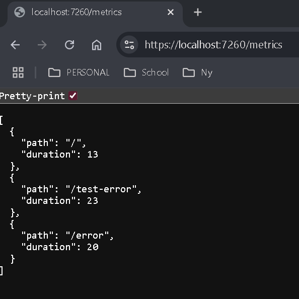
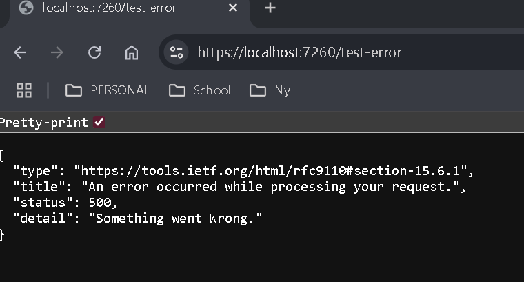

# MetricsApp
## Overview

MetricsApp is an ASP.NET Core web application that uses custom middleware to measure request processing times and handle application errors.

## Request Timing Middleware

The RequestTimingMiddleware class uses a Stopwatch to measure how long each HTTP request takes.

Each request's path and duration are logged to the console and stored in a thread-safe list containing the last 20 requests.

A try/finally block ensures request timing is recorded even when an exception occurs.

## Metrics Endpoint

The /metrics endpoint returns the most recent 20 request measurements as JSON.

### Example output:

## Error Handling

The application uses UseExceptionHandler("/error") to handle unhandled exceptions.

The /error endpoint returns an HTTP 500 response in the standard Problem Details JSON format.

A /test-error endpoint is included to demonstrate the exception-handling functionality.

### Testing Error Handling

To test the global exception handler, run the application and navigate to:

https://localhost:7260/test-error (port may differ)

This endpoint intentionally throws an exception, which is caught by the global exception handler and re-executed internally to /error.

The application then returns an HTTP 500 response containing a Problem Details JSON object with the message "Something went wrong."

You can also visit /metrics afterward to verify that both /test-error and /error were recorded by the request timing middleware.

### Example output:

